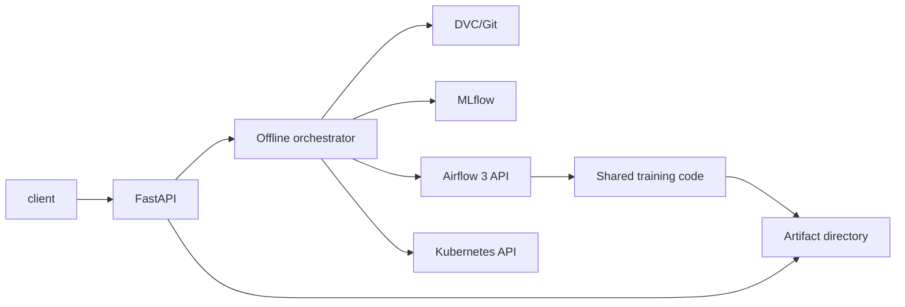

# Architecture



```text
Client -> FastAPI -> Orchestrator -> {DVC, MLflow, Airflow, Kubernetes}
                                      Airflow -> training -> artifacts -> FastAPI
```

Read-only inspection tools do not mutate state. Airflow triggering is an execution action.
Dataset reproduction and Kubernetes scaling/restart are state-changing and require explicit
confirmation; Kubernetes additionally requires the server-side approved namespace and a
single-use token. External service availability is reported as uncertainty, never guessed.

## Permission and safety matrix

| Capability | Classification | Authorization |
|---|---|---|
| DVC dataset listing, provenance, comparison, status | Read-only | Valid repository-relative paths and validated revisions |
| DVC dataset reproduction | State-changing in an isolated worktree | `execute=true` plus explicit confirmation; current worktree is not modified |
| MLflow search, run details, registry inspection | Read-only | Trusted tracking URI; structured unavailable errors |
| Airflow DAG/run/task inspection | Read-only | Airflow authentication and validated API responses |
| Airflow training trigger | Execution-triggering | Approved DAG ID only; never automatic for informational queries |
| Kubernetes inspection and diagnosis | Read-only | Valid namespace and available Kubernetes client configuration |
| Kubernetes scale/restart | State-mutating | Server-configured approved namespace, explicit confirmation, short-lived single-use token, bounded operation |
| FastAPI prediction and health endpoints | Read-only | Strict request schemas; model artifact must be available |

The in-memory Kubernetes confirmation store is intentionally single-process and is not
a distributed authorization system. Production deployments should use durable,
auditable authorization state and a dedicated identity provider.

## Evidence limitations

Offline tests use mocks and deterministic failure fixtures. They do not prove that a
local Airflow server, MLflow server, or Kubernetes cluster is reachable. The evidence
runbook in `README.md` identifies the commands that must be captured live when those
services are available.

